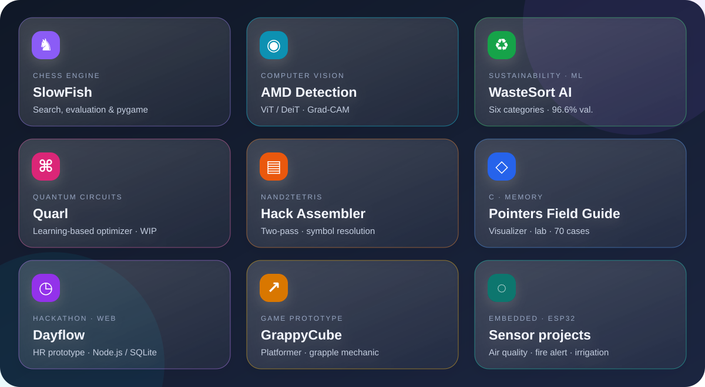

<h1 align="center">Tejaswi B Teggihalli</h1>

Computer Science · RV College of Engineering, Bengaluru

Systems, machine learning, hardware—and how they fit together.

  
  
  
  
  
  

## A little about me

Second-year CSE student who likes understanding things from the ground up—from logic gates and CPUs to neural networks. Exploring Nand2Tetris Part 2, deep learning, quantum-circuit optimization, and embedded hardware. Especially interested in interdisciplinary CS and biology.

## Selected work

A colorful snapshot of my projects—each tile has a matching link below.

| Project | What it does |
|:--|:--|
| [♞ SlowFish](https://github.com/tejaswibteggihalli/SlowFish-a-python-based-chess-engine) | Python chess engine · pygame · depth-5 search |
| [◉ AMD Detection](https://github.com/shield44-project/Age-Related-Macular-Degeneration) | Retinal screening experiments with ViT/DeiT and Grad-CAM |
| [♻ WasteSort AI](https://github.com/tejaswibteggihalli/WasteSort-AI) | Six waste classes and disposal suggestions · 96.6% validation accuracy |
| [⌘ Quarl](https://github.com/tejaswibteggihalli/3rd_sem_EL) · *in progress* | Learning-based quantum-circuit optimizer using Quartz |
| [▤ Hack Assembler](https://github.com/tejaswibteggihalli/Nand2tetris_Assembler) | Two-pass Nand2Tetris assembler with label resolution |
| [◇ C Pointers Field Guide](https://github.com/tejaswibteggihalli/Pointers_Guide) | Memory visualizer, arithmetic lab, and pointer edge cases |
| [◷ Dayflow](https://github.com/tejaswibteggihalli/Team_Ninad) | HR hackathon prototype · Node.js and SQLite |
| [↗ GrappyCube](https://github.com/tejaswibteggihalli/GrappyCube---A-scrolling-platformer) | Platformer prototype built around a grapple mechanic |
| Embedded builds | ESP32 air-quality/fire alert and sensor-driven irrigation prototypes |

Also contributed hardware time to Leela Chess Zero; college chess-team member with two tournament wins.

## Toolkit & learning

`Python` `Java` `C` `C++` `JavaScript` · `PyTorch` `Kaggle` `Jupyter` · `Arduino` `ESP32` · `Git` `Node.js` `Flask`

Nand2Tetris Part 2 · MIT 6.S191 · Python data structures, algorithms & interviews

## Contributions

<table><tr><td>

</td></tr></table>

3D calendar generated daily by <a href="https://github.com/yoshi389111/github-profile-3d-contrib">github-profile-3d-contrib</a>.

---

Open to collaboration—especially where CS meets biology. Chess · sci-fi · Veritasium.

