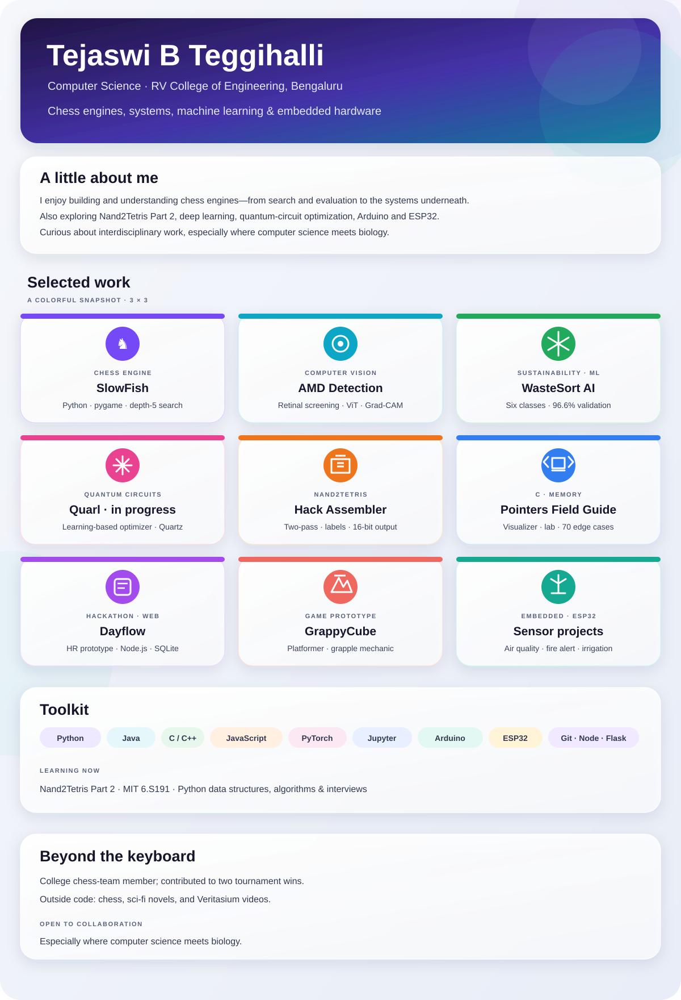

  &nbsp;&nbsp;
  &nbsp;&nbsp;
  &nbsp;&nbsp;
  &nbsp;&nbsp;
  

Computer Science · RV College of Engineering, Bengaluru · Chess engines, systems, ML &amp; hardware

## Contributions

<table><tr><td>

</td></tr></table>

3D calendar generated daily by <a href="https://github.com/yoshi389111/github-profile-3d-contrib">github-profile-3d-contrib</a>.

<a href="assets/resume/README.md">Résumé PDF — upload pending</a> · Open to collaboration, especially where CS meets biology.

