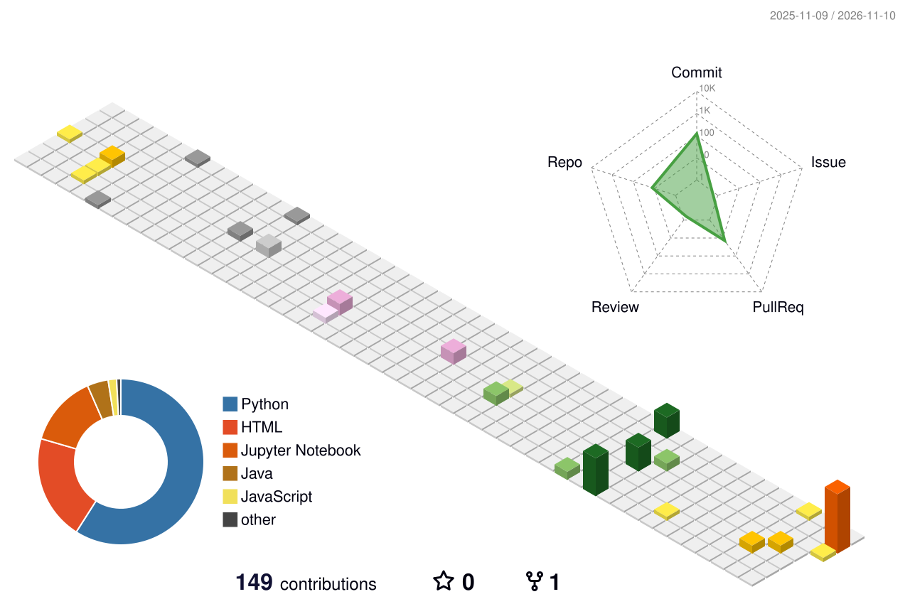

<h1 align="center">Tejaswi B Teggihalli</h1>

Computer Science student · RV College of Engineering, Bengaluru

Systems, machine learning, hardware—and how they fit together.

  
  
  
  
  
  

## About

Second-year CSE student at RV College of Engineering, Bengaluru. I like understanding things from the ground up—from logic gates and CPUs to neural networks. Currently exploring Nand2Tetris Part 2, deep learning, and a team quantum-circuit optimization project. I also work with Arduino and ESP32, and am especially interested in interdisciplinary CS and biology.

## Selected work

<table>
  <tr>
    <td width="33%"> <strong><a href="https://github.com/tejaswibteggihalli/SlowFish-a-python-based-chess-engine">SlowFish</a></strong> Python chess engine · pygame · depth-5 search.</td>
    <td width="33%"> <strong><a href="https://github.com/shield44-project/Age-Related-Macular-Degeneration">AMD Detection</a></strong> Team retinal-screening project with ViT/DeiT and Grad-CAM.</td>
    <td width="33%"> <strong><a href="https://github.com/tejaswibteggihalli/WasteSort-AI">WasteSort AI</a></strong> Classifies six waste types and suggests disposal; 96.6% validation accuracy.</td>
  </tr>
  <tr>
    <td width="33%"> <strong><a href="https://github.com/tejaswibteggihalli/3rd_sem_EL">Quarl</a></strong> in progress Learning-based quantum-circuit optimization using Quartz.</td>
    <td width="33%"> <strong><a href="https://github.com/tejaswibteggihalli/Nand2tetris_Assembler">Hack Assembler</a></strong> Two-pass assembler with label resolution and 16-bit output.</td>
    <td width="33%"> <strong><a href="https://github.com/tejaswibteggihalli/Pointers_Guide">C Pointers Field Guide</a></strong> Interactive memory visualizer, arithmetic lab, and 70 edge cases.</td>
  </tr>
  <tr>
    <td width="33%"> <strong><a href="https://github.com/tejaswibteggihalli/Team_Ninad">Dayflow</a></strong> Hackathon HR-management prototype with Node.js and SQLite.</td>
    <td width="33%"> <strong><a href="https://github.com/tejaswibteggihalli/GrappyCube---A-scrolling-platformer">GrappyCube</a></strong> Platformer prototype built around a grapple mechanic.</td>
    <td width="33%"> <strong>Embedded builds</strong> ESP32 air-quality/fire alert and sensor-driven irrigation prototypes.</td>
  </tr>
</table>

Also contributed hardware time to Leela Chess Zero; college chess-team member with two tournament wins.

## Toolkit & learning

`Python` `Java` `C` `C++` `JavaScript` · `PyTorch` `Kaggle` `Jupyter` · `Arduino` `ESP32` · `Git` `Node.js` `Flask`

Nand2Tetris Part 2 · MIT 6.S191 · Python data structures, algorithms & interviews

## Contributions

<table><tr><td>

</td></tr></table>

3D calendar generated daily by <a href="https://github.com/yoshi389111/github-profile-3d-contrib">github-profile-3d-contrib</a>.

---

Open to collaboration—especially where CS meets biology. Chess · sci-fi · Veritasium.

