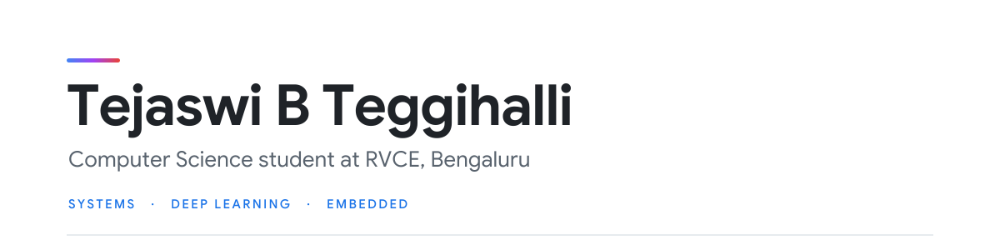

  <a href="https://www.linkedin.com/in/tejaswi-b-teggihalli-a57797382/">LinkedIn</a> &nbsp;·&nbsp;
  <a href="mailto:tejaswibteggihalli@gmail.com">Email</a> &nbsp;·&nbsp;
  <a href="https://leetcode.com/u/2HiY8Lczl5">LeetCode</a> &nbsp;·&nbsp;
  <a href="https://www.chess.com/member/teju17">Chess.com</a> &nbsp;·&nbsp;
  <a href="https://scratch.mit.edu/users/teju17/">Scratch</a>

## About

Second-year Computer Science student at R V College of Engineering, Bengaluru. I like understanding how things work from the ground up, from logic gates to CPUs to neural networks.

- Working through Nand2Tetris Part 2 and studying deep learning
- Hands-on with Arduino and ESP32 hardware
- Open to interdisciplinary work, especially where CS meets biology
- Outside code: chess, competitive swimming, sci-fi novels, and Veritasium videos

## Selected work

| Project | Details |
| :-- | :-- |
| **[SlowFish](https://github.com/tejaswibteggihalli/SlowFish-a-python-based-chess-engine)** | Chess engine with a pygame GUI, built from Eddie Sharick's tutorial and extended. Depth-5 negamax with alpha-beta pruning, move ordering and piece-square evaluation. About 30 s a move, hence the name. Python · pygame |
| **[AMD Detection](https://github.com/shield44-project/Age-Related-Macular-Degeneration)** | Team coursework project on screening for age-related macular degeneration from fundus images. A ViT-B/16 classifier (80% on a small 30-image clinical set) plus a ResNet-50 that produces Grad-CAM heatmaps. DeiT-Small reached about 91% on validation but 40% on real clinical images. Ships as a Qt desktop app with a Flask backend. Python · PyTorch · C++ · Qt · Flask |
| **[WasteSort AI](https://github.com/tejaswibteggihalli/WasteSort-AI)** | Classifies a photo of waste into six categories and suggests how to dispose of it. Fine-tuned EfficientNet-B0 on about 13.9k images, 96.6% validation accuracy. Python · PyTorch · Streamlit |
| **[Hack Assembler](https://github.com/tejaswibteggihalli/Nand2tetris_Assembler)** | Two-pass assembler for the Nand2Tetris Hack machine language. The first pass resolves labels so names can be used before they are defined; the second emits 16-bit binary. Python |
| **[C Pointers Field Guide](https://github.com/tejaswibteggihalli/Pointers_Guide)** | Interactive single-page guide to C pointers: a step-through memory visualizer, an arithmetic lab and 70 edge-case questions. Made entirely with Claude. HTML · JavaScript |
| **Air Quality & Fire Alert System** *(no public repo)* | ESP32 team project from RVCE Experiential Learning. Monitors temperature, humidity, air quality and flame, with an OLED display, buzzer alerts and Blynk integration. ESP32 · C++ · Blynk |

More projects

 

| Project | Details |
| :-- | :-- |
| [Dayflow](https://github.com/tejaswibteggihalli/Team_Ninad) | Hackathon prototype of an HR management system with a Node.js and SQLite backend |
| [GrappyCube](https://github.com/tejaswibteggihalli/GrappyCube---A-scrolling-platformer) | Promptathon 2025 entry: an unfinished platformer with a grapple mechanic |
| [Chess game (skill lab)](https://github.com/mycuriousmind/chess-game-skill_lab-project) | Contributed MongoDB-backed online play |
| [discord_bots](https://github.com/tejaswibteggihalli/discord_bots) | Discord bots hosted on Render |
| [auto_uni_wifi_login](https://github.com/igglywigglyw0rm/auto_uni_wifi_login) | Tray app that re-logs into a campus WiFi portal when the session expires |
| [EL_Projects](https://github.com/tejaswibteggihalli/EL_Projects) | Java project-based learning work |
| Arduino irrigation system | Sensor-driven automated irrigation (first-semester EL project) |
| Leela Chess Zero | Remote hardware contributor for distributed training and testing |

## Stack

| | |
| :-: | :-: |
| **Languages** | `Python` `Java` `C` `C++` |
| **ML** | `PyTorch` `Kaggle` `Jupyter` |
| **Embedded** | `Arduino` `ESP32` |
| **Tools** | `Git` `GitHub` `Node.js` `Flask` |

## Learning

- **Nand2Tetris:** Part 1 complete (logic gates to ALU to CPU to assembler); Part 2 (VM translator, compiler, OS) next
- **MIT 6.S191:** Introduction to Deep Learning
- **Python:** *The Complete Python Bootcamp* and *Python for Data Structures, Algorithms, and Interviews*

Chess

 

College chess team member who filled in for first-team players and contributed to two tournament wins. I play on [Chess.com](https://www.chess.com/member/teju17), contribute hardware time to Leela Chess Zero, and hang out on the Stockfish Discord.

 

If we share interests, or you want help with a project or idea, my DMs are open.
